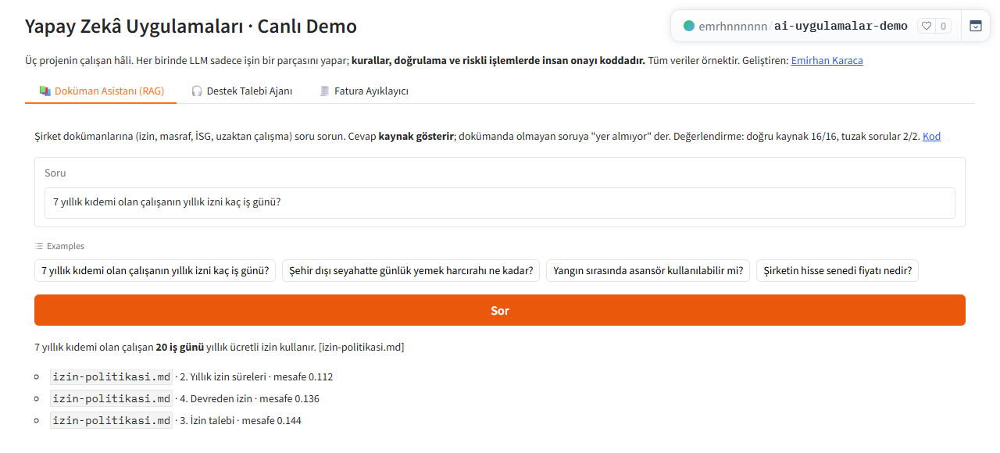
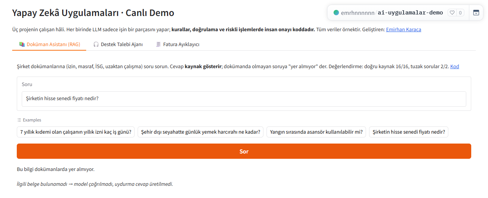

# Company Document Assistant (local RAG)

*Türkçe: [README.md](README.md)*

**Live demo:** [huggingface.co/spaces/emrhnnnnnn/ai-uygulamalar-demo](https://huggingface.co/spaces/emrhnnnnnn/ai-uygulamalar-demo), tab: 📚 Doküman Asistanı. The demo runs on OpenAI gpt-5.4-mini; the business logic is the same as in this repo.

In every company, the answer to questions like "how many days of leave do I have?" or "who do I send the expense form to?" is written in some PDF somewhere, and nobody can find that PDF. This assistant reads the company documents and answers questions. I had three conditions:
- **Data stays inside:** everything runs on my own computer.
- **Every answer shows its source:** the answer to "where did you get this?" is always there.
- **No making things up:** if the documents don't cover a question, it says so.

 

## How it works
```
docs/ (MD, TXT, PDF) → split into pieces by headings → meaning vectors (nomic-embed-text) → ChromaDB
Question → mixed search (meaning + Turkish word-root match) → similarity threshold → model (qwen2.5:3b) → answer + [source]
```
- **Heading context:** each piece carries its "Document > Section" heading, which makes finding the right piece easier.
- **Mixed search:** in Turkish, words change with suffixes ("kaybolan" / "kaybı"), and meaning search sometimes misses those matches. A second search that compares word roots catches them.
- **No making things up:** if the question is not similar enough to the documents, the model is not even called; the answer is simply "not in the documents". When the model is called, it is forced to answer only from the pieces it was given.

## Results (16 questions, 2 of them traps)
| Measure | Result |
|---|---|
| Correct source found (in the top 4 results) | **16/16** (15/16 with meaning search only) |
| Correct information in the answer | **15/16** |
| No made-up answer on trap questions | **2/2** |

That one question is the difference mixed search makes: with meaning search alone, the right piece didn't come up for it.

The one wrong answer is a reasoning error: the 3B model found the right paragraph but picked the wrong range for "7 years of seniority". A bigger model, or turning the seniority table into structured data, would fix this kind of error. Details: [eval/RAPOR.md](eval/RAPOR.md)

## Running it
```bash
pip install -r requirements.txt
ollama pull qwen2.5:3b && ollama pull nomic-embed-text
uvicorn app.main:app --reload            # http://localhost:8000
curl -X POST localhost:8000/ingest       # indexes the docs/ folder
python eval/degerlendir.py
pytest                                   # unit tests without a model (fake vectors)
```
Docker files are included (`docker compose up`: Ollama + assistant). Honest note: I haven't tested the Docker setup end to end yet; the local setup above is tested.

## Tech
Python · FastAPI · ChromaDB · Ollama · nomic-embed-text · qwen2.5:3b · pypdf · pytest · Docker

> The policies in `docs/` belong to a made-up company ("Örnek Teknoloji A.Ş.").

---
Built by **Emirhan Karaca**
